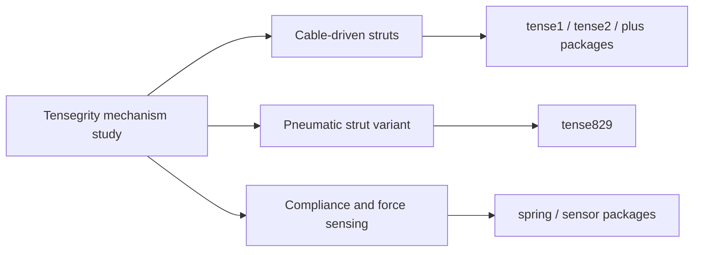

# Tensegrity Robot Mechanical Design

A mechanical design archive containing tensegrity strut variants, motor-driven cable winding, pneumatic struts, force sensing, spring mechanisms, camera gimbal mounts, manufacturing drawings and research notes. Directory names identify source packages, not verified release chronology. No final design or experimentally validated performance is asserted.

## Mechanisms and study path

*An illustration from the existing motion-study folder; it is not a photograph of a validated prototype.*

The packages are grouped by mechanism, not a verified chronological release sequence.

| Question | Start here |
| --- | --- |
| How are struts and cables arranged? | [Motion illustrations](source/%E5%BC%A0%E6%8B%89%E8%BF%90%E5%8A%A8%E7%A4%BA%E6%84%8F%E5%9B%BE) and [modeling notes](source/%E5%BB%BA%E6%A8%A1%E7%A0%94%E7%A9%B6.docx) |
| How is cable length actuated? | [Motor winding/strut models](source/tense2/) |
| What compliance and sensing mechanisms were explored? | [Spring mechanism](source/tense-spring/) and [force sensing](source/tense%2Bsenser/) |
| What is the pneumatic variant? | [Cylinder-driven strut models](source/tense829/) |
| Which parts have fabrication files? | [Assembly and manufacturing index](docs/FILE_INDEX.md) |

These materials document mechanical design exploration. No closed-loop locomotion result, load capacity or robustness metric is claimed without supporting tests.

## Source packages

| Package | Description / 内容 |
| --- | --- |
| [tense1](source/tense1) | Strut design / 张拉杆方案 |
| [tense2](source/tense2) | Motor winding and strut assemblies / 电机卷绳及张拉杆装配 |
| [tense-plus](source/tense-plus) | Alternative strut assemblies / 张拉杆扩展方案 |
| [tense2-plus](source/tense2-plus) | Strut and buffer models with manufacturing files / 张拉杆、缓冲机构与加工文件 |
| [tense829](source/tense829) | Pneumatic strut and foot / 气缸张拉杆与足端 |
| [tense902-1plus](source/tense902-1plus) | Connector variants / 连接件变型 |
| [tense+senser](source/tense%2Bsenser) | Force sensing / 力传感机构 |
| [tense-spring](source/tense-spring) | Spring compression-to-tension mechanism / 弹簧压拉转换机构 |
| [tense-spring2](source/tense-spring2) | Spring housing / 弹簧外壳 |
| [tense-grab](source/tense-grab) | Sleeve bases / 套筒底座 |
| [1](source/1) | Gimbal and electronics mounting / 云台与电子部件安装 |
| [tense-control](source/tense-control) | Camera gimbal and electronics mounting / 相机云台及电子部件安装 |
| [tense-control2](source/tense-control2) | Alternative mounting package / 另一组安装模型 |
| [内部元件及说明](source/%E5%86%85%E9%83%A8%E5%85%83%E4%BB%B6%E5%8F%8A%E8%AF%B4%E6%98%8E) | Component drawings and documentation / 元件图纸与说明 |
| [碳板出件](source/%E7%A2%B3%E6%9D%BF%E5%87%BA%E4%BB%B6) | Carbon plate drawings / 碳板加工图 |
| [教具](source/%E6%95%99%E5%85%B7) | Teaching models / 教具 |
| [张拉运动示意图](source/%E5%BC%A0%E6%8B%89%E8%BF%90%E5%8A%A8%E7%A4%BA%E6%84%8F%E5%9B%BE) | Motion illustrations / 运动示意图 |

## Start here

- [Assembly and document index](docs/FILE_INDEX.md)
- [English document reading guide](docs/READING_GUIDE_EN.md)

The archive contains 321 original files (292.59 MiB).

CAD and 3MF assets use Git LFS. Install Git LFS before `git add`; after cloning, run `git lfs pull` to retrieve the actual large files. Do not assume a web ZIP download contains them.

Supplier models are included as mechanical dependencies; they are not all original designs by the repository owner. No blanket license is assigned. Research notes are unfinished source records, not validated engineering calculations. The ultrasonic-cleaning document describes an exploratory application, not a demonstrated system.

English navigation appears before Chinese. The reading guide summarizes the Chinese documents in English; it is not a full translation. Original documents and formula graphics are preserved without alteration. External paper PDFs, the deferred technical-disclosure draft, temporary files, backups and duplicate ZIP files are omitted.

---

# 张拉整体机器人机械设计

本仓库收录张拉杆不同方案、电机卷绳、气缸张拉杆、力传感、弹簧机构、云台安装、加工图及研究笔记。

共 321 份原始材料，约 292.59 MiB。请完整保留 `source` 内部路径、零件文件名及材质贴图，避免破坏 CAD 引用。`tense-control` 文件夹主要存放机械安装模型。

请先阅读[文件索引](docs/FILE_INDEX.md)和[上传步骤](UPLOAD.md)。CAD 与 3MF 已配置 Git LFS，务必先启用 LFS 再添加文件。

说明采用英文在前、中文在后。另附英文阅读导引，原始中文文档及公式图片保持原样，尚未制作全文英文译本。建模资料属于研究笔记，清淤资料属于应用探索。供应商模型作为依赖保留。

## 中文阅读建议

先看运动示意图与建模笔记，再按电机卷绳、气缸张拉杆、弹簧及力传感机制选择模型。上方关系图按机构类型归类，不表示版本先后。图示不等于样机验证，当前材料不支持额外声称闭环运动、承载能力或鲁棒性指标。

Archive maintenance / 归档维护

[Source manifest](SOURCE_MANIFEST.csv) · [Original upload notes](UPLOAD.md)

